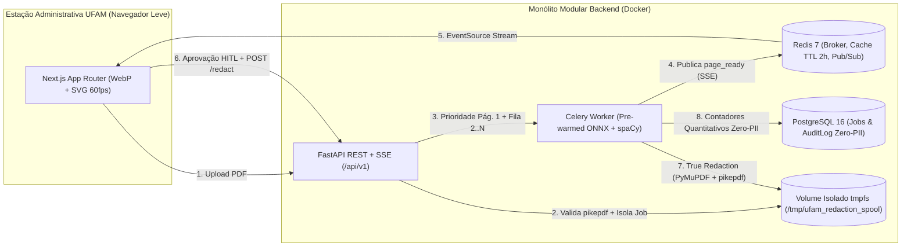

# Sistema de Identificação e Tarjamento de Dados Pessoais — UFAM

Plataforma web institucional da **Universidade Federal do Amazonas (UFAM)** projetada para identificação automatizada híbrida e **tarjamento físico definitivo (*true redaction*)** de dados pessoais e dados pessoais sensíveis em documentos PDF (textuais nativos, digitalizados/escaneados e híbridos), em estrita conformidade com a **Lei Geral de Proteção de Dados Pessoais (LGPD — Lei nº 13.709/2018)** e a **Lei de Acesso à Informação (LAI — Lei nº 12.527/2011)**.

> [!NOTE]
> **Cobertura por Testes Automatizados:** O projeto conta com suítes automatizadas de testes no **Backend** (`pytest`, incluindo validação de extração/OCR, NLP, destruição física de dados, fluxo de API, segurança *Zero-PII*, benchmarks de qualidade/SLA e a suíte ponta a ponta *"Padrão Ouro"*) e no **Frontend** (`TypeScript` *typecheck* e testes de navegador com `Playwright`, cobrindo caracterização de interface/estado e fluxo E2E). Consulte a [Seção 4](#4-testes-automatizados-e-benchmarks) para detalhes e comandos de execução.

---

## 1. Visão Geral da Arquitetura (Thin-Client + FastAPI/Celery/ONNX)

O sistema foi concebido especificamente para a realidade de infraestrutura das unidades administrativas e Pró-Reitorias da UFAM:
- **Servidores sem GPU dedicada:** Toda a inferência de OCR (`rapidocr-onnxruntime` via `onnxruntime`) e Processamento de Linguagem Natural (`spaCy` + `EntityRuler` institucional + Regex pré-compilados + Validadores Matemáticos de dígitos verificadores) roda em CPU com modelos pré-aquecidos em memória RAM (*Model Pre-Warming Singleton*), eliminando *cold starts*.
- **Estações de Trabalho Antigas (PCs de 10 a 15 anos):** O frontend **não utiliza `PDF.js` nem `react-pdf`**. Cada página do PDF é renderizada no servidor a 150 DPI como uma imagem `.webp` otimizada (~80 a 120 KB) e exibida em um **DOM Virtualizado de Página Única** (``) sobreposto por uma única camada vetorial `<svg viewBox="0 0 1000 1000">`. O desenho de tarjas manuais opera a **60 FPS** via manipulação direta de DOM com `useRef` (zero re-render no `onMouseMove`).
- **Pipeline Progressivo *First-Page-First* (SSE):** Ao enviar um documento multipágina, o backend processa a **Página 1 com prioridade imediata** (~1,0 a 1,5s), libera o Workspace de Revisão (`PARTIAL_REVIEW_READY`) e transmite as páginas `2..N` em tempo real via **Server-Sent Events (SSE)** + Redis Pub/Sub.
- **Regras Regex Personalizadas *(branch `feat/melhorias-funcionalidade`)*:** Painel opcional colapsável na área de upload (`CustomRegexPanel`) e campo opcional `custom_regexes` em `POST /api/v1/documents/upload`, permitindo cadastrar até 20 padrões específicos da unidade (com categoria LGPD, ação padrão `BLACKOUT`/`PARTIAL_MASK`, diferenciação de maiúsculas/minúsculas e validação anti-ReDoS / anti-match vazio). As detecções aparecem no workspace como `CUSTOM:<NOME>` (`CUSTOM_REGEX`) sem alterar o fluxo padrão quando omitido.
- **Política *Zero-PII* em Logs, Banco de Dados e Relatórios:** Nem o banco de dados PostgreSQL (`audit_logs`), nem os logs estruturados JSON (`ZeroPIIFilter`), nem o Relatório Institucional em PDF armazenam ou reproduzem CPFs, nomes ou textos extraídos dos documentos.



---

## 2. Taxonomia Legal de Dados (LGPD & LAI)

O motor híbrido classifica rigorosamente cada ocorrência nas **4 categorias estritas**:

| Categoria | Base Legal | Exemplos no Domínio UFAM | Cor Semântica na Revisão |
| :--- | :--- | :--- | :--- |
| `PERSONAL_COMMON` | Art. 5º, I, LGPD | Nome completo, CPF, RG, CNH, Passaporte, Título de Eleitor, PIS/PASEP, SIAPE, Matrícula UFAM, E-mail, Telefone, Endereço, CEP, Assinatura visual, Processo SEI nominal | Azul (`#2563eb`) |
| `PERSONAL_SENSITIVE` | Art. 5º, II, LGPD | Códigos médicos CID-10/CID-11, atestados/laudos periciais, filiação sindical (ex.: ADUA/SINTEST), autodeclaração étnico-racial | Vermelho (`#dc2626`) |
| `FINANCIAL_BANKING` | Sigilo Funcional / Bancário | Agência bancária, Conta Corrente com dígito, Chave PIX, Remuneração bruta/líquida (tratado com alto rigor, porém jamais classificado como dado sensível do Art. 5º, II) | Roxo (`#7c3aed`) |
| `MINOR_OR_DEPENDENT` | Art. 14, LGPD | Dados de crianças, adolescentes, dependentes funcionais e beneficiários de pensão alimentícia | Laranja (`#d97706`) |

> [!IMPORTANT]
> **Distinção Legal Obrigatória (Art. 5º, XI, LGPD):** O **tarjamento definitivo (*true redaction*)** destrói irreversivelmente os fluxos de texto, vetores e pixels nas regiões selecionadas, mas **não garante por si só a anonimização integral do documento** caso o contexto narrativo remanescente permita identificação indireta. A revisão humana (*Human-in-the-Loop*) pela unidade administrativa responsável é etapa obrigatória antes da publicação.

---

## 3. Como Executar o Ambiente Completo com Docker Compose

### Pré-requisitos
- Docker Engine 24+ e Docker Compose v2+

### Passo a Passo Rápido
1. Copie o arquivo de variáveis de ambiente de exemplo na raiz do projeto:
   ```bash
   cp .env.example .env
   ```
2. Suba toda a infraestrutura (PostgreSQL 16, Redis 7, Backend FastAPI, Worker Celery, Celery Beat e Frontend Next.js):
   ```bash
   docker compose up --build -d
   ```
3. Verifique a saúde dos serviços:
   - **Frontend Institucional UFAM:** `http://localhost:3000`
   - **Healthcheck Backend (PostgreSQL + Redis):** `http://localhost:8000/api/v1/health`
   - **Documentação OpenAPI / Swagger:** `http://localhost:8000/api/v1/docs`

---

## 4. Testes Automatizados e Benchmarks

A aplicação possui testes automatizados para validação contínua do **Backend** (`pytest`), da **Interface Web** (`Playwright` + `TypeScript`) e dos requisitos de **qualidade, segurança e desempenho**.

### 4.1. Testes Automatizados de Backend, NLP, SLA e Segurança (`pytest`)
No diretório `backend/`:
```bash
python -m pytest tests/ -v -s -p no:dash
```
A suíte de backend contempla:
- `tests/test_extraction.py`: Validação anti-malware `pikepdf`, renderização `.webp` (< 120 KB) e OCR seletivo ONNX;
- `tests/test_pii_detector.py`: Validadores matemáticos reais (CPF, CNPJ, CNH, PIS/PASEP, Título de Eleitor), supressão de processos SEI meramente organizacionais e classificação LGPD;
- `tests/test_true_redaction.py`: Destruição física de glifos (`PDF_REDACT_TEXT_REMOVE`), queima de pixels (`PDF_REDACT_IMAGE_PIXELS`), sanitização `pikepdf` e validação cirúrgica por recorte;
- `tests/test_api_workflow.py`: Pipeline progressivo *First-Page-First*, streaming SSE e geração do Relatório PDF Zero-PII;
- `tests/test_quality_and_sla.py`: Benchmark sobre base sintética de 10 páginas aferindo `Precision`, `Recall`, `F1-Score`, `Mean IoU` e cumprimento dos SLAs (`Página 1 < 1,8s`, `Análise 10p < 3,0s`, `Redação + Validação 10p < 2,0s`);
- `tests/test_security.py`: Bloqueio de `/JavaScript` e `/Launch`, isolamento de diretórios temporários e garantia de `Zero-PII` nos logs e banco;
- `tests/test_gold_standard_suite.py`: Suíte *"Padrão Ouro"* ponta a ponta (sem mocks) validando tabelas estreitas multi-linha, PDFs 100% escaneados via OCR ONNX, transição dinâmica entre `BLACKOUT` e `PARTIAL_MASK` no mesmo `job_id` e auditoria *Zero-PII* do `report.pdf`.
- `tests/test_custom_regex.py` *(branch `feat/melhorias-funcionalidade`)*: Validação de sintaxe, proteção anti-ReDoS/match vazio, detecção no pipeline híbrido, destruição física no PDF e integração REST em `/api/v1/documents/upload`.

### 4.2. Testes Automatizados de Frontend e End-to-End (`TypeScript` & `Playwright`)
No diretório `frontend/`:

1. **Verificação estática de tipos e build de produção:**
   ```bash
   npm run typecheck
   npm run build
   ```
2. **Testes de caracterização de UI e comportamento (`e2e/ui_characterization.spec.ts`):**
   Valida de forma determinística (via interceptação de rede) o fluxo completo de 7 etapas, alternância entre múltiplos documentos na fila, atalhos de teclado, modos `Tarjar` / `Mascarar` / `Manter`, sincronização por `group_id`, integridade das coordenadas SVG e (na branch `feat/melhorias-funcionalidade`) o painel opcional de regex personalizado:
   ```bash
   npx playwright test e2e/ui_characterization.spec.ts
   ```
3. **Suíte End-to-End completa (`Playwright` + Backend FastAPI + Frontend Next.js):**
   Executa o orquestrador que sobe o backend FastAPI e o frontend Next.js em produção e roda toda a suíte `Playwright` (`e2e/ui_characterization.spec.ts` e `e2e/redaction_workflow.spec.ts`):
   ```bash
   python e2e/run_e2e.py
   ```
   Ou, com os servidores já em execução:
   ```bash
   npm run test:e2e
   ```

---

## 5. Documentação de Implantação e Operação Institucional
Consulte o guia detalhado em [`docs/DEPLOYMENT_UFAM.md`](file:///C:/Users/gbas9/Desktop/ferramenta/docs/DEPLOYMENT_UFAM.md) para informações sobre:
- Variáveis de ambiente de produção (`.env.example`);
- Integração com **Keycloak OIDC institucional da UFAM** e perfis RBAC;
- Política de armazenamento volátil em RAM (`tmpfs`) e expurgo automático Zero-Retention;
- Procedimentos de backup e retenção da trilha de auditoria (`audit_logs`) no PostgreSQL 16.
